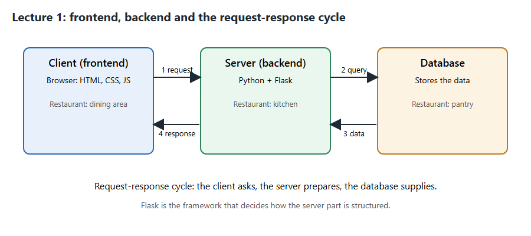
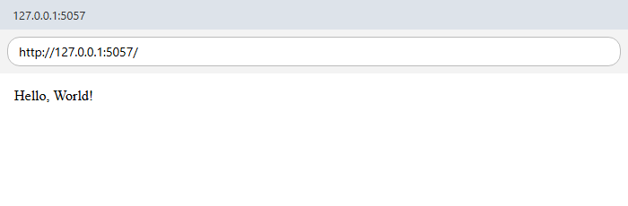
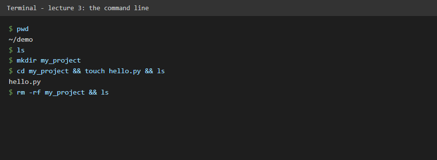
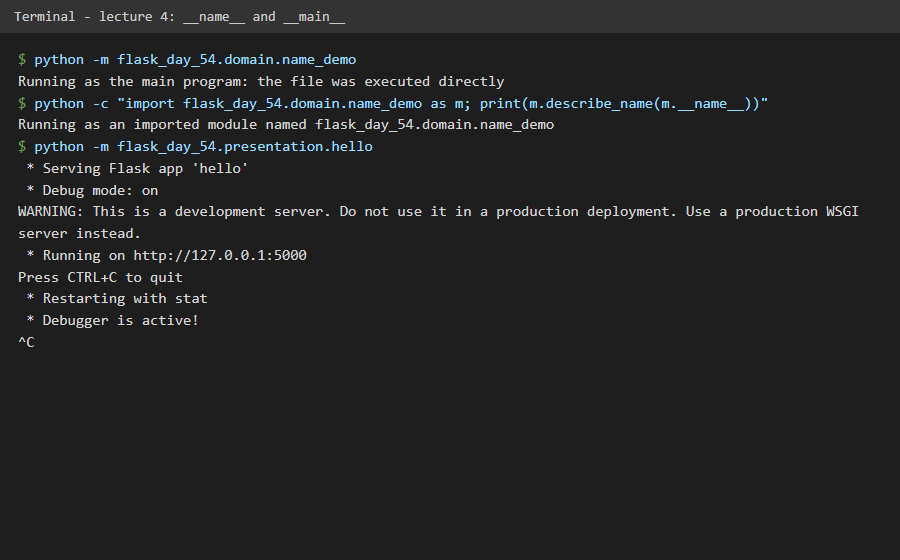
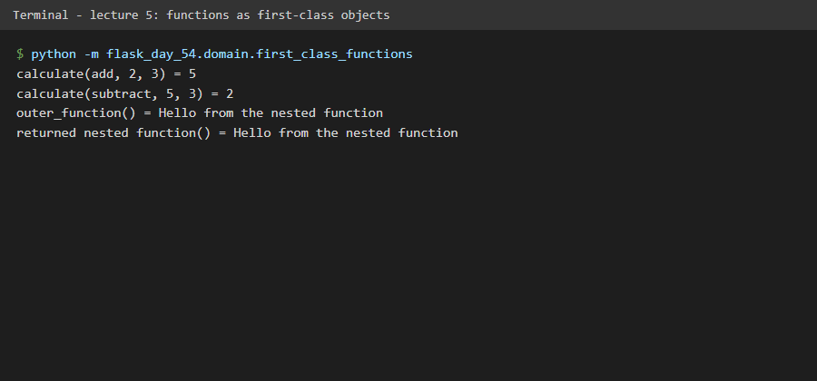
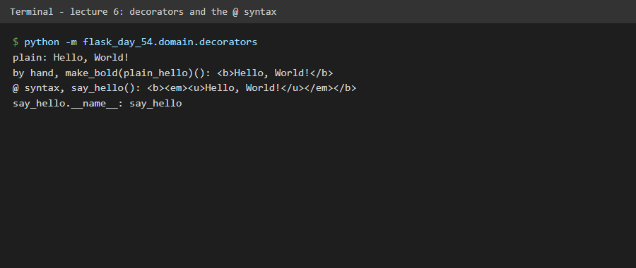

# 🚀 Flask Day 54: 100 Days of Code

Runnable, tested solutions for Day 54 of Udemy's "100 Days of Code: The Complete Python Pro Bootcamp": a first Flask server, the command line, `__name__` and `__main__`, functions as first-class objects, and decorators. It is written for fellow course participants and for visitors who want a readable example.

## 📚 Table of Contents

- [Overview](#-overview)
- [Requirements](#-requirements)
- [Setup](#-setup)
- [Run](#-run)
- [Tests](#-tests)
- [License](#-license)
- [Links](#-links)
- [Appendix: Project documents](#-appendix-project-documents)

## 🧭 Overview

The repository holds one small module per lecture step.

| Folder | What it holds |
| --- | --- |
| `src/flask_day_54/` | The lecture code in four layers: `domain`, `application`, `infrastructure`, `presentation` (see ADR-0001); each layer keeps its constants in `constants.py` |
| `tests/` | pytest tests: `unit/` for `domain` and `application`, `e2e/` for the Flask application |
| `docs/` | Project documents, the screenshots in `docs/images/` and the wiki sources in `docs/wiki/` |

Doxygen comments in the source describe every public name; `Doxyfile` builds them into `docs/doxygen/`.

The wiki (English, Danish and Bahasa Malaysia) explains what each lecture taught; its sources are in `docs/wiki/` and are published to the repository wiki when they are merged to `main`.

### Lecture steps

Each lecture has its own screenshot in `docs/images/` (made by `docs/images/capture.py` with a headless browser, so no window opens on your desktop) and a wiki page that explains what the lecture taught.

**Lecture 1: frontend, backend and the request-response cycle.** The client asks, the Flask server prepares the answer, the database supplies data.



**Lecture 2: the first Flask server.** `hello.py` serves "Hello, World!" from the home route. Start it with `flask --app flask_day_54.presentation.hello run` (or set `FLASK_APP`: `export FLASK_APP=flask_day_54.presentation.hello` on macOS and Linux, `$env:FLASK_APP = "flask_day_54.presentation.hello"` in PowerShell, `set FLASK_APP=flask_day_54.presentation.hello` in Command Prompt, then `flask run`).



**Lecture 3: the command line.** `pwd`, `ls`, `cd`, `mkdir`, `touch` and `rm` (with `rm -rf` as the command to double-check). `flask_day_54.domain.cli_basics` lists them with their Windows equivalents: `python -m flask_day_54.domain.cli_basics`. The screenshot shows the real commands run in a temporary folder.



**Lecture 4: `__name__` and `__main__`.** A file run directly has `__name__ == "__main__"`; an imported file has its module name. `app.run()` sits under that check in `hello.py`, so there are two ways to start the server: `flask --app flask_day_54.presentation.hello run` or `python -m flask_day_54.presentation.hello`. Try `python -m flask_day_54.domain.name_demo`.



**Lecture 5: functions are first-class objects.** A function can be passed as an argument (`calculate(add, 2, 3)`), defined inside another function and returned from it. See `flask_day_54.domain.first_class_functions`; run it with `python -m flask_day_54.domain.first_class_functions`.



**Lecture 6: decorators and the `@` syntax.** `@make_bold` above a function is shorthand for `say_hello = make_bold(say_hello)`. See `flask_day_54.domain.decorators`; run it with `python -m flask_day_54.domain.decorators`.



## 📋 Requirements

- Python 3.13 or newer, because the project sets `requires-python = ">=3.13"` in `pyproject.toml`.
- `venv`, which is part of Python, to keep the packages in a local `.venv`.
- Flask (the optional `web` extra) only for the web lectures. The pure-Python lectures need no package.
- pytest (the `dev` extra) to run the tests.
- Doxygen, optional, to build the API documentation.

## 🛠️ Setup

Create and use a local `.venv`, then upgrade pip and install the project in editable mode.

Windows (PowerShell):

```powershell
python -m venv .venv
.\.venv\Scripts\Activate.ps1
python -m pip install --upgrade pip
python -m pip install -e ".[dev]"
```

macOS and Linux:

```bash
python3 -m venv .venv
source .venv/bin/activate
python -m pip install --upgrade pip
python -m pip install -e ".[dev]"
```

Leave the environment with `deactivate`. The `.venv` folder is ignored by git. Install only `.[web]` if you do not need pytest.

## ▶️ Run

The lecture code is added milestone by milestone. Once the Flask application exists, start the server with either:

```bash
flask --app flask_day_54.presentation.hello run
python -m flask_day_54.presentation.hello
```

Then open `http://127.0.0.1:5000/`. Stop the server with `Ctrl+C`.

## 🧪 Tests

```bash
python -m pytest
```

Optional style checks (the `dev` extra installs ruff):

```bash
python -m ruff format --check src tests
python -m ruff check src tests
```

## 📄 License

GNU Affero General Public License v3.0, see [LICENSE][license].

## 🔗 Links

- [Repository][repository]
- [Documentation][documentation]
- [Issue tracker][issues]

## 📎 Appendix: Project documents

| Document | What it tells you |
| --- | --- |
| [AGENTS.md][agents] | The rules AI agents follow in this repository |
| [Business Case][BC-001] | Why the project exists, its scope and success criteria |
| [Stakeholder Analysis][SA-001] | Who is involved; the stakeholder IDs used for owners and reviewers |
| [Project Plan][PP-001] | The gateways and their schedule |
| [Milestones][milestones] | One document per gateway: Go/No-Go criteria and tasks |
| [Artifact registry][registry] | Where each artifact type lives, the next version, the PO language and domain |
| [Domain dictionary][DICT-001] | The PO terms and the IT terms |
| [Traceability matrix][TM-001] | How the artifacts link and when each was last reviewed |
| [Framework README][framework-readme] | The framework this project uses |
| [Framework changelog][framework-changelog] | What changed in each framework release |

---

[license]: ./LICENSE
[repository]: https://git.tirsystem.com/Tirsvad-Udemy-100-days-of-code/054-flask
[documentation]: https://git.tirsystem.com/Tirsvad-Udemy-100-days-of-code/054-flask/wiki
[issues]: https://git.tirsystem.com/Tirsvad-Udemy-100-days-of-code/054-flask/issues
[agents]: ./AGENTS.md
[BC-001]: ./docs/business-case.md
[SA-001]: ./docs/stakeholder-analysis.md
[PP-001]: ./docs/project-plan.md
[milestones]: ./docs/milestones/
[registry]: ./docs/artifact-registry.md
[DICT-001]: ./docs/dictionary.md
[TM-001]: ./docs/sqa/traceability-matrix.md
[framework-readme]: ./framework/README.md
[framework-changelog]: ./framework/CHANGELOG.md
