# Project Plan: Flask Backend Basics

## Metadata
| Key | Value |
| --- | --- |
| ID | PP-001 |
| CrossReference | [BC-001], [SA-001], [MIL-001], [MIL-002], [MIL-003], [MIL-004], [MIL-005] |
| Language | en |
| Domain | it |

## Version History
| Date | Status | Author | Reviewer | Change | Commit |
| --- | --- | --- | --- | --- | --- |
| 2026-11-06 | Accepted | Jens Tirsvad Nielsen | S01 | Initial version | [73a5a95] |

---

## Purpose

Schedule the five gateways that turn the Day 54 lectures into a tested, documented repository, within the Business Case constraint of one branch and pull request per milestone.

## Planning Assumptions

- Work starts 2026-11-06 and ends by 2026-11-10; one gateway per day or less.
- Each gateway is one branch and one pull request that closes its issues (SA-001 CM-001).
- The reviewer for every gateway is S01; in autonomous mode the AI acts as stand-in for S01 and records `Mode: autonomous, not independent`.
- PO language is English, domain IT; the wiki exists in English, Danish and Bahasa Malaysia.
- Sources: the dates and the one-pull-request-per-milestone rule come from the Product Owner's brief and [BC-001] Constraints; the review cadence follows [SA-001] CM-001.

## Gateway Schedule

| Gateway | Document | Window | Decision date | Owner | Stories | Main deliverable | Milestone |
| --- | --- | --- | --- | --- | --- | --- | --- |
| Foundation | [MIL-001] | 2026-11-06 | 2026-11-06 | S01 | none (technical tasks) | pyproject, gitignore, constants, Doxyfile, README, repo metadata | not yet synced |
| Backend and Hello Flask | [MIL-002] | 2026-11-06 to 2026-11-07 | 2026-11-07 | S01 | none (technical tasks) | hello.py, tests, screenshots 1 and 2 | not yet synced |
| Command line and __main__ | [MIL-003] | 2026-11-07 to 2026-11-08 | 2026-11-08 | S01 | none (technical tasks) | main guard, name_demo, cli_basics, screenshots 3 and 4 | not yet synced |
| Functions and decorators | [MIL-004] | 2026-11-08 to 2026-11-09 | 2026-11-09 | S01 | none (technical tasks) | first_class_functions, decorators, screenshots 5 and 6 | not yet synced |
| Docs and wiki | [MIL-005] | 2026-11-09 to 2026-11-10 | 2026-11-10 | S01 | none (technical tasks) | three-language wiki, Doxygen, code review | not yet synced |

```plantuml
@startgantt
Project starts 2026-11-06
[Foundation] starts 2026-11-06 and ends 2026-11-06
[Foundation Go/No-Go] happens 2026-11-06
[Backend and Hello Flask] starts 2026-11-06 and ends 2026-11-07
[Backend Go/No-Go] happens 2026-11-07
[Command line and main] starts 2026-11-07 and ends 2026-11-08
[CLI Go/No-Go] happens 2026-11-08
[Functions and decorators] starts 2026-11-08 and ends 2026-11-09
[Functions Go/No-Go] happens 2026-11-09
[Docs and wiki] starts 2026-11-09 and ends 2026-11-10
[Docs Go/No-Go] happens 2026-11-10
@endgantt
```



## Scope Coverage

| Business Case scope item | Gateway |
| --- | --- |
| Python source under `src/`, tests under `tests/`, documents under `docs/` | MIL-001 to MIL-004 |
| `pyproject.toml`, `constants.py`, `.gitignore`, Doxyfile, Doxygen comments | MIL-001, MIL-005 |
| README with `.venv`, run and test instructions | MIL-001 to MIL-004 |
| Wiki in en, da, ms with screenshots | MIL-005 |
| Repository description and topics | MIL-001 |

## Dependencies

```
MIL-001 -> MIL-002 -> MIL-003 -> MIL-004 -> MIL-005
```

A No-Go on a gateway moves every later gateway by the time needed to fix and re-review it. S01 decides whether the end date 2026-11-10 moves; the Business Case sets no fixed deadline, so a move needs only a new Version History row of this plan.

## Plan Risks

| Risk | Impact | Mitigation |
| --- | --- | --- |
| Headless screenshot tooling is not available (BC-001 risk 1) | Screenshots delayed | Use Edge or Chrome headless on the host (no user input is taken); otherwise a container |
| Gitea API token lacks scope for topics or wiki (BC-001 risk 3 context) | Metadata or wiki not published | Stop and report; the author sets it by hand |
| Repository URL in the brief differs from `origin` | Work lands in the wrong repository | Work against `origin`; record the difference under Open Issues |

## Open Issues

- The brief names `https://git.tirsystem.com/Tirsvad-Udemy-100_days_of_code`; `origin` is `Tirsvad-Udemy-100-days-of-code/054-flask`. The plan uses `origin`. Confirm if the other is meant.
- "Python greater than 3.13" is read as `>=3.13` (the installed interpreter is 3.13).
- S03 asks for no runtime dependencies while Flask is required by the assignment; resolved by making Flask the optional extra `web` (SA-001 conflict table).
- The lecture text mentions the `calculate` function and a greeting decorator only in prose; names and exact behaviour follow that prose.

---

[BC-001]: ./business-case.md
[SA-001]: ./stakeholder-analysis.md
[MIL-001]: ./milestones/mil-001-foundation.md
[MIL-002]: ./milestones/mil-002-hello-flask.md
[MIL-003]: ./milestones/mil-003-cli-and-main.md
[MIL-004]: ./milestones/mil-004-functions-decorators.md
[MIL-005]: ./milestones/mil-005-docs-wiki.md
[73a5a95]: https://git.tirsystem.com/Tirsvad-Udemy-100-days-of-code/054-flask/commit/73a5a95d28db041e4f27342cc552e18f7d386410
