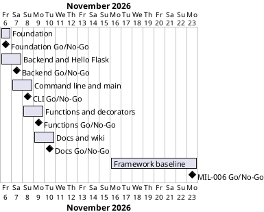

# Project Plan: Flask Backend Basics

## Metadata
| Key | Value |
| --- | --- |
| ID | PP-001 |
| CrossReference | [BC-001], [SA-001], [MIL-001], [MIL-002], [MIL-003], [MIL-004], [MIL-005], [MIL-006] |
| Language | en |
| Domain | education |

## Version History
| Date | Status | Author | Reviewer | Change | Commit |
| --- | --- | --- | --- | --- | --- |
| 2026-11-06 | Deprecated | Jens Tirsvad Nielsen | S01 | Initial version | [73a5a95] |
| 2026-11-06 | Deprecated | Jens Tirsvad Nielsen | S01 | Link each gateway to its synced Gitea milestone | [8cd73cc] |
| 2026-11-16 | Accepted | Jens Tirsvad Nielsen | AI as stand-in for S01 | Added the baseline gateway MIL-006 with its schedule row, scope coverage, dependency, risk and Gantt entries; recorded the move of the end date, the domain, the open pull request #38 and the screenshot tool in the Planning Assumptions and Open Issues; set the domain to education; reviewed in autonomous mode, not independent | pending |

---

## Purpose

Schedule the five gateways (and, since the baseline gateway [MIL-006], a sixth) that turn the Day 54 lectures into a tested, documented repository, within the Business Case constraint of one branch and pull request per milestone.

## Planning Assumptions

- Work starts 2026-11-06 and ends by 2026-11-10; one gateway per day or less.
- The baseline gateway MIL-006 starts 2026-11-16 and ends 2026-11-23, one week (source: [BC-001], Constraints). It brings the finished project to the baseline of the framework, a decision of S01. The decision dates of the earlier gateways stay as they were, so the end date of the plan moves from 2026-11-10 to 2026-11-23.
- For MIL-006 S01 has authorised the assistant to commit, push, open the pull request and merge it, and the review is done by an AI stand-in for S01 (source: [BC-001], Constraints and Risks).
- Each gateway is one branch and one pull request that closes its issues (SA-001 CM-001).
- The reviewer for every gateway is S01; in autonomous mode the AI acts as stand-in for S01 and records `Mode: autonomous, not independent`.
- PO language is English; the domain is IT until [MIL-006] and education since; the wiki exists in English, Danish and Bahasa Malaysia.
- Sources: the dates and the one-pull-request-per-milestone rule come from the Product Owner's brief and [BC-001] Constraints; the review cadence follows [SA-001] CM-001.

## Gateway Schedule

| Gateway | Document | Window | Decision date | Owner | Stories | Main deliverable | Milestone |
| --- | --- | --- | --- | --- | --- | --- | --- |
| Foundation | [MIL-001] | 2026-11-06 | 2026-11-06 | S01 | none (technical tasks) | pyproject, gitignore, constants, Doxyfile, README, repo metadata | [Milestone 001][GM-001] |
| Backend and Hello Flask | [MIL-002] | 2026-11-06 to 2026-11-07 | 2026-11-07 | S01 | none (technical tasks) | hello.py, tests, screenshots 1 and 2 | [Milestone 002][GM-002] |
| Command line and __main__ | [MIL-003] | 2026-11-07 to 2026-11-08 | 2026-11-08 | S01 | none (technical tasks) | main guard, name_demo, cli_basics, screenshots 3 and 4 | [Milestone 003][GM-003] |
| Functions and decorators | [MIL-004] | 2026-11-08 to 2026-11-09 | 2026-11-09 | S01 | none (technical tasks) | first_class_functions, decorators, screenshots 5 and 6 | [Milestone 004][GM-004] |
| Docs and wiki | [MIL-005] | 2026-11-09 to 2026-11-10 | 2026-11-10 | S01 | none (technical tasks) | three-language wiki, Doxygen, code review | [Milestone 005][GM-005] |
| Framework baseline | [MIL-006] | 2026-11-16 to 2026-11-23 | 2026-11-23 | S01 | none (technical tasks) | Branch `mil-006-framework-baseline` merged: the adopted framework release, the README, licence and project URL metadata, `.editorconfig`, `.env.example`, the language line at the top of each wiki page, the traceability matrix and review records | [Milestone 006][GM-006] |



## Scope Coverage

| Business Case scope item | Gateway |
| --- | --- |
| Python source under `src/`, tests under `tests/`, documents under `docs/` | MIL-001 to MIL-004 |
| `pyproject.toml`, `constants.py`, `.gitignore`, Doxyfile, Doxygen comments | MIL-001, MIL-005 |
| README with `.venv`, run and test instructions | MIL-001 to MIL-004 |
| Wiki in en, da, ms with screenshots | MIL-005 |
| Repository description and topics | MIL-001 |
| The baseline: framework release, README, licence and project URL metadata, editor settings, environment template, traceability matrix, review records (objective 6) | MIL-006 |

## Dependencies

```
MIL-001 -> MIL-002 -> MIL-003 -> MIL-004 -> MIL-005 -> MIL-006
```

A No-Go on a gateway moves every later gateway by the time needed to fix and re-review it. S01 decides whether the end date 2026-11-10 moves; the Business Case sets no fixed deadline, so a move needs only a new Version History row of this plan.

## Plan Risks

| Risk | Impact | Mitigation |
| --- | --- | --- |
| Headless screenshot tooling is not available (BC-001 risk 1) | Screenshots delayed | Use Edge or Chrome headless on the host (no user input is taken); otherwise a container |
| Gitea API token lacks scope for topics or wiki (BC-001 risk 3 context) | Metadata or wiki not published | Stop and report; the author sets it by hand |
| Repository URL in the brief differs from `origin` | Work lands in the wrong repository | Work against `origin`; record the difference under Open Issues |
| A continuous integration (CI) check fails on the pull request of MIL-006 | The merge is delayed past 2026-11-23 | The failure is fixed on the same branch and the checks run again; after three failed rounds on one cause the work stops and S01 decides (trace: success criterion 7 of [BC-001]) |

## Open Issues

- The brief names `https://git.tirsystem.com/Tirsvad-Udemy-100_days_of_code`; `origin` is `Tirsvad-Udemy-100-days-of-code/054-flask`. The plan uses `origin`. Confirm if the other is meant.
- "Python greater than 3.13" is read as `>=3.13` (the installed interpreter is 3.13).
- S03 asks for no runtime dependencies while Flask is required by the assignment; resolved by making Flask the optional extra `web` (SA-001 conflict table).
- The lecture text mentions the `calculate` function and a greeting decorator only in prose; names and exact behaviour follow that prose.
- Domain: since [MIL-006] the plan, the Business Case and the baseline milestone have the domain `education`. The other documents (Stakeholder Analysis, Domain Dictionary, milestones MIL-001 to MIL-005 and the review records RC-001 to RC-022) keep the domain `it` they were accepted with; they are not changed by the baseline, and a change of their domain would need a new review of each.
- The git host also has the open pull request #38 (framework submodule URL in lowercase); the baseline delivers the same change in the pull request of MIL-006, and S01 closes #38 after the merge.
- The development server starts in debug mode on 127.0.0.1 (`DEBUG` in the infrastructure constants); it is for local use only and must not be exposed. MIL-006 starts no server, takes no screenshot and runs the tests only.
- The review of the wiki in MIL-006 found that every page starts with its title and has the language line second, while criterion 11 of the wiki checklist (Mandatory) says every page starts with the language line; the earlier review records RC-019 and RC-022 passed it. MIL-006 moves the language line to the first line of the 24 pages and changes no other wiki text.
- `docs/images/capture.py`, the screenshot tool of [MIL-005], carries `# nosemgrep` markers from that milestone. MIL-006 does not change it; whether those markers are still needed is left to a later milestone.

---

[BC-001]: ./business-case.md
[SA-001]: ./stakeholder-analysis.md
[MIL-001]: ./milestones/mil-001-foundation.md
[MIL-002]: ./milestones/mil-002-hello-flask.md
[MIL-003]: ./milestones/mil-003-cli-and-main.md
[MIL-004]: ./milestones/mil-004-functions-decorators.md
[MIL-005]: ./milestones/mil-005-docs-wiki.md
[73a5a95]: https://git.tirsystem.com/Tirsvad-Udemy-100-days-of-code/054-flask/commit/73a5a95d28db041e4f27342cc552e18f7d386410
[GM-001]: https://git.tirsystem.com/Tirsvad-Udemy-100-days-of-code/054-flask/milestone/342
[GM-002]: https://git.tirsystem.com/Tirsvad-Udemy-100-days-of-code/054-flask/milestone/343
[GM-003]: https://git.tirsystem.com/Tirsvad-Udemy-100-days-of-code/054-flask/milestone/344
[GM-004]: https://git.tirsystem.com/Tirsvad-Udemy-100-days-of-code/054-flask/milestone/345
[GM-005]: https://git.tirsystem.com/Tirsvad-Udemy-100-days-of-code/054-flask/milestone/346
[8cd73cc]: https://git.tirsystem.com/Tirsvad-Udemy-100-days-of-code/054-flask/commit/8cd73cc46b3f791e0c23a60809a50e4140089d4e
[MIL-006]: ./milestones/mil-006-framework-baseline.md
[GM-006]: https://git.tirsystem.com/Tirsvad-Udemy-100-days-of-code/054-flask/milestone/573
